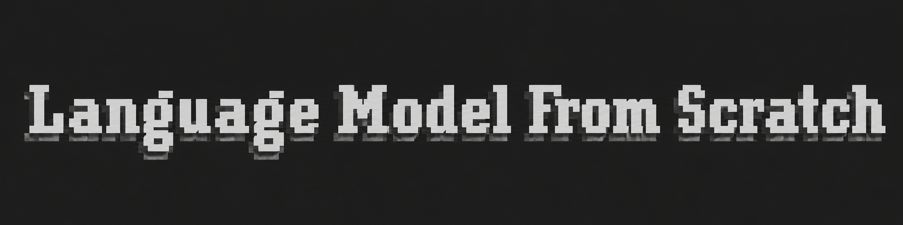
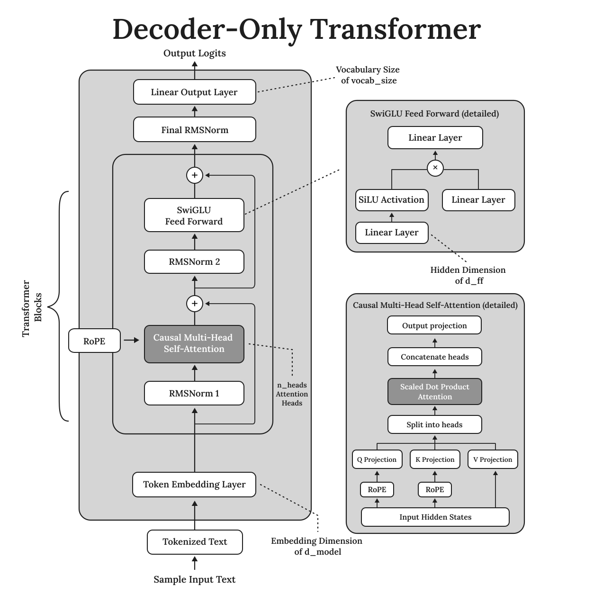
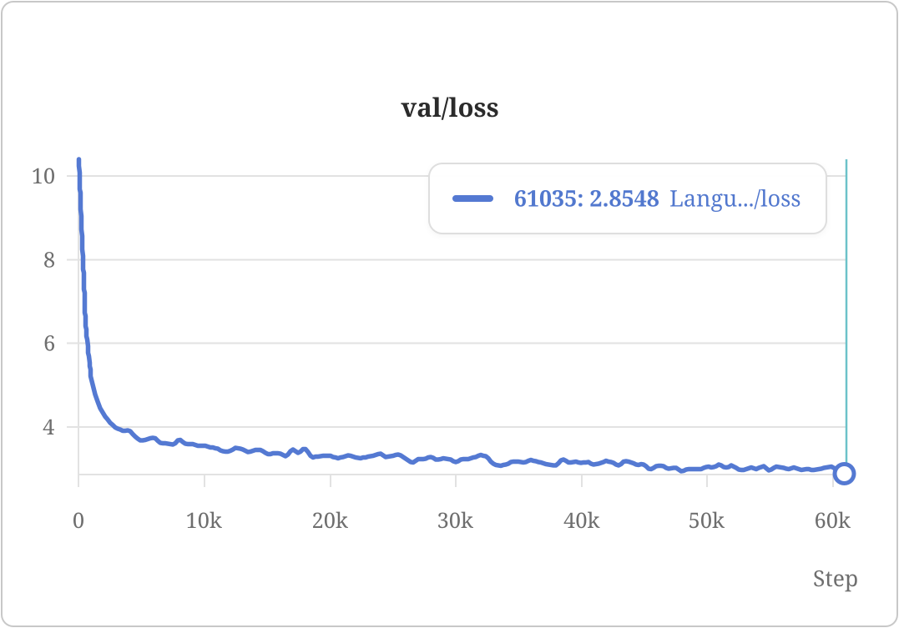

<p align="center">
  
</p>


Este repositório contêm uma implementação simples e organizada de um **Modelo de Linguagem Causal** baseado na arquitetura **Transformer Decoder-only**, desenvolvido e treinado do zero usando apenas **dados em português**.

O modelo de ~**50m de parâmetros**, foi desenvolvido usando [`Pytoch`](https://pytorch.org/) e treinado na etapa de **pretraining** com **~1B de tokens** do dataset [`Corpus Carolina`](https://sites.usp.br/corpuscarolina/).

**Os componentes principais foram escritos manualmente, sem recorrer a módulos prontos como `nn.Linear` ou `F.scaled_dot_product_attention`**: camadas lineares e de embedding, RMSNorm, SwiGLU, RoPE, atenção multi-head causal, softmax, cross-entropy, AdamW, schedule de learning rate, gradient clipping e amostragem de tokens. A atenção é explícita (sem FlashAttention), o que favorece a clareza do código em troca de eficiência.

## Arquitetura

A arquitetura é fortemente inspirada no [Llama 2](https://ai.meta.com/research/publications/llama-2-open-foundation-and-fine-tuned-chat-models/), um marco para os LLMs open source que popularizou componentes que hoje são praticamente padrão. Foram adotados três deles:

- **RoPE (Rotary Positional Embedding)**
- **SwiGLU (Swish-Gated Linear Unit)**
- **RMSNorm (Root Mean Square Layer Normalization)**

O **GQA (Grouped-Query Attention)** não foi utilizado, e o modelo usa a **MHA (Multi-Head Attention)** original, para simplificar a implementação. O **KV Cache** também ficou de fora, mas ele é uma otimização de inferência e não altera a arquitetura nem o treinamento. Sua ausência torna apenas a geração mais lenta, já que o contexto é reprocessado a cada novo token.

<p align="center">
  
</p>


O tokenizer usado é o do [TeenyTinyLlama-160m](https://huggingface.co/nicholasKluge/TeenyTinyLlama-160m), que utiliza o algoritmo **BPE (Byte-Pair Encoding)** e foi treinado em dados em português. Como o foco do projeto é o modelo de linguagem causal, ele foi reaproveitado sem nenhum treinamento adicional.


## Parêmetros

| Parâmetro | Valor |
|---|---:|
| Parêmetros Totais | **51.45M** |
| Tamanho do Vocabulário (`vocab_size`) | 32.000 |
| Tamanho do Contexto (`context_length`) | 256 |
| Dimensão do Modelo (`d_model`) | 512 |
| Dimensão da Camada Feed-Forward (`d_ff`) | 1.344 |
| Número de Cabeças de Atenção (`num_heads`) | 8 |
| Número de Camadas (`num_layers`) | 6 |
| RoPE Theta (`theta`) | 10.000 |

## Dados

### Corpus Carolina

O dataset Corpus Carolina foi escolhido por causa de dados relativamente limpos e com alta qualidade. De acordo com as suas especificações no [huggingface](https://huggingface.co/datasets/carolina-c4ai/corpus-carolina), possui 15 GB de dados textuais totalmente em português e dividido entre os seguintes grupos: Wikis, Datasets and other Corpora, Legislative Branch, Judicial Branch, University Domains, Social Media, Public Domain Works. 

## Tokenização 

A tokenização do dataset resultou no total de **~1.7b de tokens**, sendo distribuído em ~1.6b para o conjunto de treino, ~17m para a validação e ~16m para o teste.

## Treinamento

O treinamento usou o otimizador `AdamW` com schedule de learning rate **cosine annealing com warmup linear** e atingiu uma **loss final de 2,8548** (perplexidade ≈ 17,4). O treinamento ocorreu em **1b de tokens**, com a duração de **~8 horas** em **1x GPU NVIDIA Tesla T4**.

Cada step processa 64 sequências de 256 tokens (16.384 tokens), e 61.036 steps somam 1.000.013.824 tokens. Isso dá **~19,4 tokens por parâmetro**, próximo da razão de ~20 tokens por parâmetro que o artigo do Chinchilla ([Hoffmann et al., 2022](https://arxiv.org/abs/2203.15556)) indica como ideal para o orçamento de computação.



### Configuração do Treinamento

| Parâmetro | Valor padrão |
|---|---|
| `n_steps` | `61036` |
| `batch_size` | `64` |
| `amp_dtype` | `float16` |
| `gradient_clipping` | `True` |
| `l2_norm_max` | `1.0` |


### Otimizador

| Parâmetro | Valor padrão |
|---|---|
| `betas` | `(0.90, 0.95)` |
| `min_learning_rate` | `5e-5` |
| `max_learning_rate` | `5e-4` |
| `warmup_iters` | `1500` |
| `cosine_cycle_iters` | `61035` |
| `weight_decay` | `0.1` |

## Quickstart

Este projeto utiliza o [`uv`](https://docs.astral.sh/uv/) como gerenciador de dependências. Para instalar as dependências:

```
uv sync
source .venv/bin/activate
```

### Reprodução

Os valores padrão dos scripts reproduzem o treinamento descrito acima. A preparação baixa o corpus completo e gera ~3,4 GB de arquivos `.bin` (1,7B de tokens × 2 bytes) em `data/corpuscarolina/processed/`.

```bash
uv run data/corpuscarolina/prepare.py
uv run train.py
```

Algumas observações úteis:

- O `train.py` registra métricas no [Weights & Biases](https://wandb.ai/) por padrão. Rode `wandb login` antes ou desative o log com `--no-wandb_log`.
- Para retomar um treinamento, use `--ckpt_path outputs/<checkpoint>.pt`.
- Para testar a preparação dos dados rapidamente, use `--taxonomies pub --max-documents 20` (veja `data/corpuscarolina/README.md`).

## Resultados

| Métrica | Valor |
|---|---:|
| Loss final (cross-entropy) | **2,8548** |
| Perplexidade equivalente (`exp(loss)`) | ~**17,4** |
| Tokens vistos no treinamento | ~1B (1.000.013.824) |
| Razão tokens / parâmetros | ~19,4x |
| Duração do treinamento | ~8 h em 1x NVIDIA Tesla T4 |
| Vazão média aproximada | ~35 mil tokens/s |

Algumas observações sobre o comportamento do modelo, a partir dos exemplos da seção seguinte:

- **Fluência local:** o modelo produz frases gramaticalmente plausíveis em português e reproduz o estilo dos domínios dominantes do corpus. O prompt `Belém é`, por exemplo, gera uma frase no formato típico de verbetes da Wikipédia.
- **Coerência global limitada:** com ~51M de parâmetros e contexto de 256 tokens, o modelo perde consistência factual e semântica em gerações mais longas (veja `Era uma vez`). Isso é esperado nessa escala e não indica um erro de implementação.
- **Cópia em contexto:** no teste com o padrão repetido `DCBA`, o modelo continua corretamente a sequência, o que é consistente com a capacidade de reconhecer e repetir padrões já vistos no contexto.

## Exemplos

O notebook `generate.ipynb` contém alguns exemplos de geração de texto pelo modelo. Os três primeiros usam `temperature=0.9` e o último usa geração determinística (`temperature=0.0`):

``` text
Prompt: O Pará é
Output: O Pará é uma região que se desenvolveu como uma 
área de maior crescimento. Atualmente, a Universidade

Prompt: O Brasil é
Output: O Brasil é um país soberano e um país soberano 
de milhões de anos, todos que

Prompt: Era uma vez
Output: Era uma vez um príncipe com mais coragem que 
os habitantes moradias que viram acontecer? Sabe, 
quero falar do grande interesse de pessoas da família 
do meu Brasil, a grande "Iol fossem do meu subsolo". 
Quero falar o que eu tenho a dizer sobre a família

Prompt: DCBA DCBA DCBA DCBA DC
Output: DCBA DCBA DCBA DCBA DCBA
```

## Estrutura do Repositório

```text
.
├── assets/                     # Imagens do README (banner, arquitetura, curva de loss)
├── data/corpuscarolina/
│   ├── prepare.py              # Download, tokenização e split do Corpus Carolina
│   └── README.md               # Detalhes da preparação dos dados
├── languagemodel/
│   ├── model.py                # Transformer (RoPE, SwiGLU, RMSNorm, MHA causal)
│   ├── optimizer.py            # AdamW, schedule cosseno com warmup e gradient clipping
│   ├── dataloader.py           # Amostragem de batches a partir dos arquivos .bin
│   ├── generation.py           # Amostragem de tokens (temperatura e nucleus sampling) e geração
│   ├── functional.py           # Softmax, cross-entropy e funções auxiliares
│   └── checkpoint_manager.py   # Salvar e carregar checkpoints
├── generate.ipynb              # Exemplos de geração de texto
├── train.py                    # Script de treinamento
└── pyproject.toml              # Dependências (gerenciadas com uv)
```

## License

Este projeto está licenciado sob a Licença MIT. Consulte o arquivo [LICENSE](LICENSE) para mais detalhes.